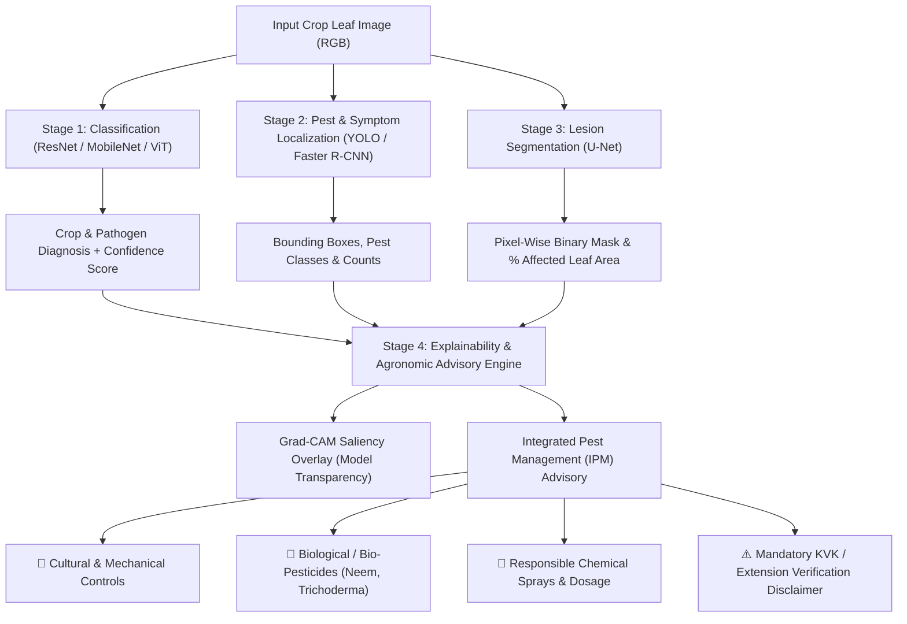

# 🌾 Crop Disease & Pest Vision (CSE471 & SIH26131)

[](https://www.python.org/)
[](https://pytorch.org/)
[-purple.svg)](#course-syllabus--practical-traceability-matrix)
[](#sih26131-problem-statement--system-architecture)
[](LICENSE)

An academic and hackathon-grade Deep Learning & Computer Vision framework designed to solve **Smart India Hackathon Problem Statement SIH26131** while satisfying every theoretical and experimental learning requirement of **CSE471: Deep Learning for Computer Vision (L:2 T:0 P:2, 3 Credits)**.

Built by **Harshit Chauhan** (`harshitchauhann95` / `harshitchauhan05spn@gmail.com`).

---

## 📑 Table of Contents
1. [Dual Alignment: CSE471 Syllabus & SIH26131 Problem Statement](#1-dual-alignment-cse471-syllabus--sih26131-problem-statement)
2. [Course Syllabus & Practical Traceability Matrix (CO1–CO6, Units I–VI, Practicals 1–10)](#2-course-syllabus--practical-traceability-matrix)
3. [SIH26131 System Architecture: 4-Stage Diagnostic & Advisory Pipeline](#3-sih26131-system-architecture)
4. [Public Agricultural Datasets & Acquisition](#4-public-agricultural-datasets--acquisition)
5. [Repository Structure](#5-repository-structure)
6. [Installation & Quickstart](#6-installation--quickstart)
7. [Running the Interactive Web App & CLI](#7-running-the-interactive-web-app--cli)
8. [Git Workflow & Commit Milestones](#8-git-workflow--commit-milestones)

---

## 1. Dual Alignment: CSE471 Syllabus & SIH26131 Problem Statement

This project bridges rigorous computer vision theory with real-world agricultural engineering:

```
┌────────────────────────────────────────────────────────┐
│     CSE471: Deep Learning for Computer Vision          │
│     (Course Outcomes CO1–CO6, Units I–VI, Practicals)  │
└───────────────────────────┬────────────────────────────┘
                            │ Theoretical Foundations,
                            │ Mathematical Formulations &
                            │ Baseline Model Implementations
                            ▼
┌────────────────────────────────────────────────────────┐
│     SIH26131: Early Detection and Management of        │
│     Crop Diseases and Pest Infestations                │
└───────────────────────────┬────────────────────────────┘
                            │ Applied Real-World Deployment
                            ▼
┌────────────────────────────────────────────────────────┐
│     4-Stage Crop Health & Agronomic Advisory Engine    │
│  [Classification] ➔ [Detection] ➔ [Segmentation] ➔     │
│             [Grad-CAM XAI & IPM Extension]             │
└────────────────────────────────────────────────────────┘
```

- **CSE471 (Deep Learning for Computer Vision):** Covers pixel arrays, color models, 2D convolution arithmetic from scratch, classical CNNs (LeNet, AlexNet, VGG, ResNet, Inception), transfer learning, single-stage and two-stage object detectors (YOLO, Faster R-CNN), semantic segmentation (U-Net, DeepLab), Vision Transformers (ViT, Swin), and Explainable AI (Grad-CAM, saliency maps).
- **SIH26131 (Smart India Hackathon):** Solves crop yield loss by automatically diagnosing leaf diseases, locating damaging foliar pests, measuring the exact percentage of infected leaf surface area, explaining model predictions via Grad-CAM, and generating non-prescriptive, field-tested agronomic management advisories adhering to ICAR / KVK guidelines.

---

## 2. Course Syllabus & Practical Traceability Matrix

Every syllabus topic, Course Outcome (CO), Unit, and Practical is implemented across dedicated modules and executable Jupyter notebooks:

| Unit & CO | Syllabus Topics & Theoretical Concepts | Practical / Experiment | Implementation File(s) |
| :--- | :--- | :--- | :--- |
| **Unit I**<br>`CO1` | Image representation (pixels, channels, RGB/HSV/LAB/Grayscale color spaces), resizing, cropping, normalization; perceptrons, activations (ReLU, LeakyReLU, GELU, Sigmoid, Softmax), losses (Cross-Entropy, Focal Loss), optimizers. | **Practical 1:** OpenCV image loading, resizing, grayscale/HSV/LAB conversion, normalization, Matplotlib visualization. | [`src/transforms.py`](file:///Users/harshitchauhann/Desktop/cse471/src/transforms.py)<br>[`01_prac01_opencv_preprocessing.ipynb`](file:///Users/harshitchauhann/Desktop/cse471/notebooks/01_prac01_opencv_preprocessing.ipynb) |
| **Unit II**<br>`CO2` | 2D discrete convolution from scratch, filters/kernels, feature maps, padding (valid vs. same), stride, pooling (max vs. avg), receptive fields; LeNet-5, ResNet-18 with residual skip connections $\mathcal{F}(x)+x$, BatchNorm, Dropout. | **Practical 2:** 2D spatial convolution from scratch in NumPy with Sobel, Laplacian, Gaussian kernels.<br>**Practical 3:** Stride, padding, max/avg pooling & receptive field expansion.<br>**Practical 4:** Train LeNet vs. ResNet-18; compare parameters, time, and residual gradient flow. | [`src/models_cnn.py`](file:///Users/harshitchauhann/Desktop/cse471/src/models_cnn.py)<br>[`02_prac02_numpy_2d_conv_filters.ipynb`](file:///Users/harshitchauhann/Desktop/cse471/notebooks/02_prac02_numpy_2d_conv_filters.ipynb)<br>[`03_prac03_conv_stride_padding_features.ipynb`](file:///Users/harshitchauhann/Desktop/cse471/notebooks/03_prac03_conv_stride_padding_features.ipynb)<br>[`04_prac04_lenet_vs_resnet18_mnist.ipynb`](file:///Users/harshitchauhann/Desktop/cse471/notebooks/04_prac04_lenet_vs_resnet18_mnist.ipynb) |
| **Unit III**<br>`CO3` | Transfer learning paradigms, pre-trained backbones (ResNet, MobileNet, EfficientNet), feature extraction vs. fine-tuning, layer freezing/unfreezing, differential learning rates ($\eta_{backbone} \ll \eta_{head}$), lab-to-field domain adaptation. | **Practical 5:** Feature extraction using pre-trained backbone + classifier with confusion matrix.<br>**Practical 6:** Fine-tune MobileNet on Healthy vs. Diseased leaf subset; evaluate freezing vs. unfreezing. | [`src/dataset.py`](file:///Users/harshitchauhann/Desktop/cse471/src/dataset.py)<br>[`src/models_cnn.py`](file:///Users/harshitchauhann/Desktop/cse471/src/models_cnn.py)<br>[`05_prac05_feature_extraction_classifier.ipynb`](file:///Users/harshitchauhann/Desktop/cse471/notebooks/05_prac05_feature_extraction_classifier.ipynb)<br>[`06_prac06_mobilenet_finetuning_unfreezing.ipynb`](file:///Users/harshitchauhann/Desktop/cse471/notebooks/06_prac06_mobilenet_finetuning_unfreezing.ipynb) |
| **Unit IV**<br>`CO4` | Bounding-box geometry (xyxy, xywh, cxcywh), Intersection over Union (IoU), Non-Maximum Suppression (NMS) from scratch; single-stage (YOLO, SSD) vs. two-stage (Faster R-CNN with RPN & RoIAlign); evaluation metrics (mAP@0.5, PR curves). | **Practical 7:** YOLO foliar pest detection, bounding boxes, labels, confidence, FPS/latency analysis.<br>**Practical 8:** Fine-tune Faster R-CNN on crop pests/lesions; evaluate detection loss, IoU, and mAP@0.5. | [`src/detector.py`](file:///Users/harshitchauhann/Desktop/cse471/src/detector.py)<br>[`07_prac07_yolo_object_detection.ipynb`](file:///Users/harshitchauhann/Desktop/cse471/notebooks/07_prac07_yolo_object_detection.ipynb)<br>[`08_prac08_faster_rcnn_finetuning.ipynb`](file:///Users/harshitchauhann/Desktop/cse471/notebooks/08_prac08_faster_rcnn_finetuning.ipynb) |
| **Unit V**<br>`CO5` | Semantic vs. instance segmentation, U-Net (encoder-decoder + skip connections), Dice Loss, IoU (Jaccard); Vision Transformers (patch projection, self-attention, multi-head attention, positional encoding, ViT, Swin Transformer). | **Practical 9:** U-Net segmentation model generating pixel-wise disease masks, alpha-blended overlays, and % area severity.<br>**SIH Topic:** Vision Transformers (ViT & Swin patch attention from scratch). | [`src/segmenter.py`](file:///Users/harshitchauhann/Desktop/cse471/src/segmenter.py)<br>[`09_prac09_unet_segmentation_overlay.ipynb`](file:///Users/harshitchauhann/Desktop/cse471/notebooks/09_prac09_unet_segmentation_overlay.ipynb)<br>[`11_sih_vit_swin_clip_generative_experiments.ipynb`](file:///Users/harshitchauhann/Desktop/cse471/notebooks/11_sih_vit_swin_clip_generative_experiments.ipynb) |
| **Unit VI**<br>`CO6` | Generative models (VAEs, DCGAN, CycleGAN domain adaptation), Vision-Language Models (CLIP zero-shot prompt matching), Explainable AI (Grad-CAM, saliency maps) auditing correct vs. misclassified samples. | **Practical 10:** Grad-CAM & gradient saliency visualization comparing correct vs. misclassified foliar samples.<br>**SIH Finale:** 4-Stage End-to-End AgriVision Pipeline and Agronomic Extension Advisory Engine. | [`src/vlm_and_gradcam.py`](file:///Users/harshitchauhann/Desktop/cse471/src/vlm_and_gradcam.py)<br>[`src/advisory.py`](file:///Users/harshitchauhann/Desktop/cse471/src/advisory.py)<br>[`src/app.py`](file:///Users/harshitchauhann/Desktop/cse471/src/app.py)<br>[`10_prac10_gradcam_saliency_analysis.ipynb`](file:///Users/harshitchauhann/Desktop/cse471/notebooks/10_prac10_gradcam_saliency_analysis.ipynb)<br>[`12_sih_end_to_end_crop_pipeline.ipynb`](file:///Users/harshitchauhann/Desktop/cse471/notebooks/12_sih_end_to_end_crop_pipeline.ipynb) |

---

## 3. SIH26131 System Architecture

The end-to-end crop health pipeline integrates four complementary vision and agronomic reasoning stages:



### The 4 Stages in Detail:
1. **Stage 1 — Leaf Disease Classification:** Identifies crop species (Tomato, Potato, Rice, Apple, Corn) and pathogenic condition (Early Blight, Late Blight, Leaf Blast, Scab, or Healthy) with softmax probability confidence.
2. **Stage 2 — Pest & Symptom Localization:** Pinpoints discrete damaging agents (`aphid`, `armyworm`, `whitefly`, `leaf_miner`, `blight_spot`) using bounding boxes and Non-Maximum Suppression.
3. **Stage 3 — Foliar Lesion Semantic Segmentation:** Uses U-Net to delineate necrotic lesion boundaries at pixel precision and calculates the percentage of damaged leaf surface area to stratify severity:
   - **Mild (Stage 1):** $< 10\%$ surface area
   - **Moderate (Stage 2):** $10\% - 30\%$ surface area
   - **Severe (Stage 3):** $> 30\%$ surface area
4. **Stage 4 — Explainability & Agronomic Advisory Engine:**
   - Visualizes Grad-CAM heatmaps to prove the model is focusing on genuine biological lesions rather than background soil or lighting artifacts.
   - Outputs a field advisory mapped to crop, pathogen, and severity, including cultural sanitation, biological treatments (e.g. *Trichoderma viride*, cold-pressed neem oil), and targeted chemical interventions with dosage guidelines following Indian Council of Agricultural Research (ICAR) and Central Insecticides Board (CIBRC) standards.
   - Enforces a mandatory advisory disclaimer directing farmers to local Krishi Vigyan Kendras (KVKs).

---

## 4. Public Agricultural Datasets & Acquisition

This framework utilizes three established benchmark agricultural vision datasets:

| Modality | Public Benchmark Dataset | Key Characteristics | Academic Role |
| :--- | :--- | :--- | :--- |
| **Classification** | **PlantVillage** vs. **PlantDoc** | 54,306 lab images (PlantVillage) paired with 2,598 field images (PlantDoc) | Benchmark CNN training and domain adaptation (Unit III & CO3) |
| **Object Detection** | **Crop Pest & Foliar Disease (Roboflow / VOC / YOLO)** | Bounding boxes for aphids, armyworms, whiteflies, leaf miners, lesions | Real-time localization and mAP evaluation (Unit IV & CO4) |
| **Segmentation** | **PlantDoc Foliar Lesion Segmentation** | Pixel-level ground-truth masks for necrotic foliar spots | U-Net training, Dice score, and % area severity (Unit V & CO5) |

### Reproducible Data Acquisition Script:
```bash
# 1. Generate lightweight, realistic sample subsets for immediate offline testing (No downloads required!)
python scripts/download_datasets.py --generate-samples

# 2. Download full public datasets (Requires Kaggle API in ~/.kaggle/kaggle.json)
python scripts/download_datasets.py --download-all

# 3. Download specific modality
python scripts/download_datasets.py --dataset plantvillage
python scripts/download_datasets.py --dataset plantdoc
python scripts/download_datasets.py --dataset pests
```

> **Git Cleanliness:** Raw datasets and generated media are strictly excluded via `.gitignore`. The repository remains ultra-lightweight and Python-only.

---

## 5. Repository Structure

```text
crop-disease-pest-vision-cse471/
├── README.md                                          # Comprehensive project & syllabus documentation
├── requirements.txt                                  # Dependency specifications
├── .gitignore                                        # Excludes datasets, model checkpoints, and venvs
├── configs/
│   └── config.yaml                                   # Centralized configuration (paths, classes, hyperparameters)
├── data/
│   ├── README.md                                     # Dataset acquisition & benchmark documentation
│   └── samples/                                      # Offline sample subsets (generated via script)
├── notebooks/
│   ├── 01_prac01_opencv_preprocessing.ipynb           # Practical 1: Color spaces & pixel representation
│   ├── 02_prac02_numpy_2d_conv_filters.ipynb         # Practical 2: 2D spatial convolution from scratch
│   ├── 03_prac03_conv_stride_padding_features.ipynb  # Practical 3: Stride, padding, pooling & RF arithmetic
│   ├── 04_prac04_lenet_vs_resnet18_mnist.ipynb       # Practical 4: LeNet-5 vs. ResNet-18 skip connections
│   ├── 05_prac05_feature_extraction_classifier.ipynb # Practical 5: Frozen feature extraction + head training
│   ├── 06_prac06_mobilenet_finetuning_unfreezing.ipynb# Practical 6: Layer freezing vs. partial fine-tuning
│   ├── 07_prac07_yolo_object_detection.ipynb         # Practical 7: YOLO foliar pest detection & NMS
│   ├── 08_prac08_faster_rcnn_finetuning.ipynb        # Practical 8: Two-stage Faster R-CNN fine-tuning
│   ├── 09_prac09_unet_segmentation_overlay.ipynb     # Practical 9: U-Net segmentation & % area severity
│   ├── 10_prac10_gradcam_saliency_analysis.ipynb     # Practical 10: Grad-CAM on correct vs. misclassified leaves
│   ├── 11_sih_vit_swin_clip_generative_experiments.ipynb # SIH: ViT, Swin attention, CLIP & Generative models
│   └── 12_sih_end_to_end_crop_pipeline.ipynb         # SIH: Grand 4-stage pipeline & agronomic advisory
├── src/
│   ├── __init__.py                                   # Package metadata
│   ├── dataset.py                                    # PyTorch Datasets & DataLoaders (classification/det/seg)
│   ├── transforms.py                                 # Image preprocessing & data augmentations
│   ├── models_cnn.py                                 # LeNet, ResNet18Scratch, transfer classifiers, Focal & Dice Loss
│   ├── detector.py                                   # IoU, NMS from scratch, Faster R-CNN, mAP calculation
│   ├── segmenter.py                                  # U-Net from scratch, Dice score, disease severity calculator
│   ├── vlm_and_gradcam.py                            # Grad-CAM from scratch, saliency maps, CLIP prompt matcher
│   ├── advisory.py                                   # Agronomic Knowledge Base & ICAR/KVK advisory engine
│   └── app.py                                        # Standalone CLI demo & Streamlit Web Dashboard
└── scripts/
    ├── download_datasets.py                          # Automated dataset fetcher & sample generator
    ├── generate_notebooks.py                         # Programmatic notebook builder (nbformat)
    └── run_git_commits.sh                            # Atomic milestone commit & Git configuration script
```

---

## 6. Installation & Quickstart

### Prerequisites
- Python 3.10, 3.11, or 3.12 (macOS Apple Silicon MPS, Linux CUDA, or Windows CPU supported)
- Git & SSH configured

### 1. Clone & Set Up Virtual Environment
```bash
git clone git@github.com:harshitchauhann95/crop-disease-pest-vision-cse471.git
cd crop-disease-pest-vision-cse471

python3 -m venv .venv
source .venv/bin/activate  # On Windows: .venv\Scripts\activate
```

### 2. Install Dependencies
```bash
pip install -r requirements.txt
```

### 3. Generate Offline Testing Subsets
```bash
python scripts/download_datasets.py --generate-samples
```

---

## 7. Running the Interactive Web App & CLI

### Option A: Interactive Streamlit Dashboard
Launch the multi-stage visual diagnostic application in your web browser:
```bash
streamlit run src/app.py
```
- Upload any crop leaf image or select from pre-loaded demonstration samples.
- View real-time outputs across all 4 stages: classification, bounding box localization, U-Net mask overlay, Grad-CAM attribution, and actionable agronomic advisory cards.

### Option B: Standalone CLI Demo
Run the automated end-to-end pipeline directly in your terminal:
```bash
# Run on built-in sample leaf
python src/app.py --demo

# Run on custom leaf image
python src/app.py --image path/to/leaf_image.jpg
```

---

## 8. Git Workflow & Commit Milestones

### Recommended Repository Name
We recommend naming this repository:
```
crop-disease-pest-vision-cse471
```
*(Alternative: `agri-vision-sih26131`)*

### How to Rename the GitHub Repository & Push Cleanly
1. Open your browser and navigate to: `https://github.com/harshitchauhann95/fake`
2. Go to **Settings** $\to$ **General** $\to$ **Repository name**.
3. Change `fake` to `crop-disease-pest-vision-cse471` and click **Rename**.
4. In your terminal, run the automated atomic commit script:

```bash
bash scripts/run_git_commits.sh
```

5. Push the structured branch to GitHub:
```bash
git push -u origin main --force
```

*(If you prefer to keep the remote name as `fake`, simply run: `git remote set-url origin git@github.com:harshitchauhann95/fake.git && git push -u origin main`)*

### Atomic Git Commit History Sequence
The repository history is organized into eight logical, atomic commits:
1. `feat(setup): initialize environment, config, and dataset acquisition pipeline`
2. `feat(foundations): implement color spaces, 2d conv from scratch, and lenet vs resnet18`
3. `feat(transfer-learning): add feature extraction, layer freezing, and mobilenet fine-tuning`
4. `feat(detection): implement iou, nms from scratch, and yolo/faster r-cnn pest detection`
5. `feat(segmentation): implement u-net from scratch and foliar lesion severity estimation`
6. `feat(xai-vlm): implement grad-cam from scratch, saliency maps, vit, and clip prompt matching`
7. `feat(sih26131): build multi-stage crop vision pipeline and agronomic advisory engine`
8. `docs(academic): add comprehensive syllabus mapping, traceability matrix, and user guide`

---

## 🎓 Academic Integrity & Authorship
- **Author:** Harshit Chauhan
- **Degree:** Final Year B.Tech Computer Science & Engineering
- **Course:** CSE471 — Deep Learning for Computer Vision (3 Credits)
- **Problem Statement:** SIH26131 (Smart India Hackathon)
